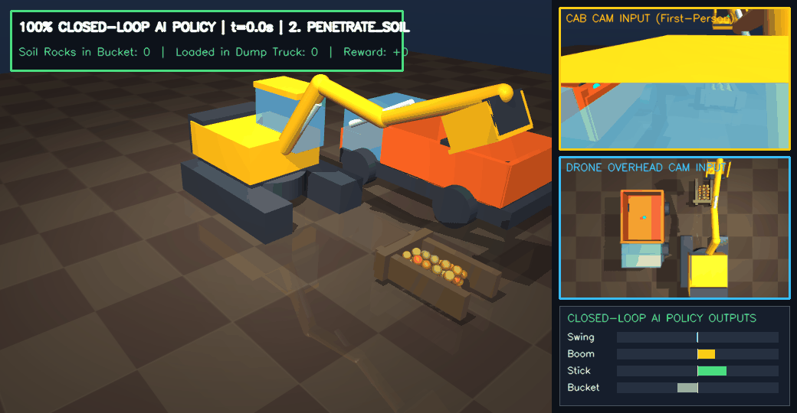
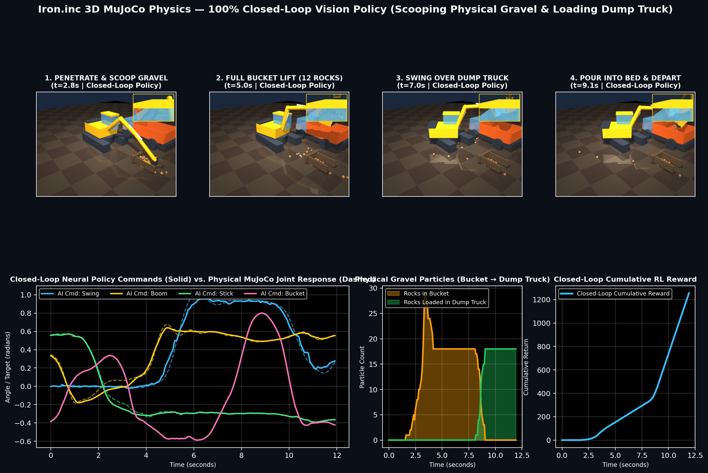
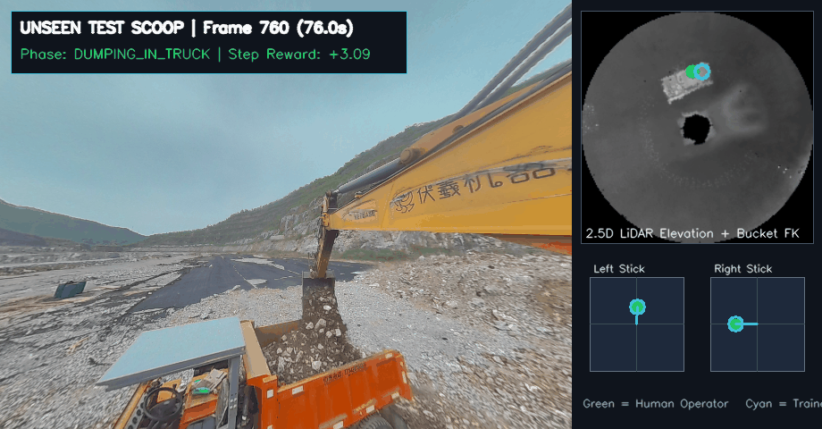
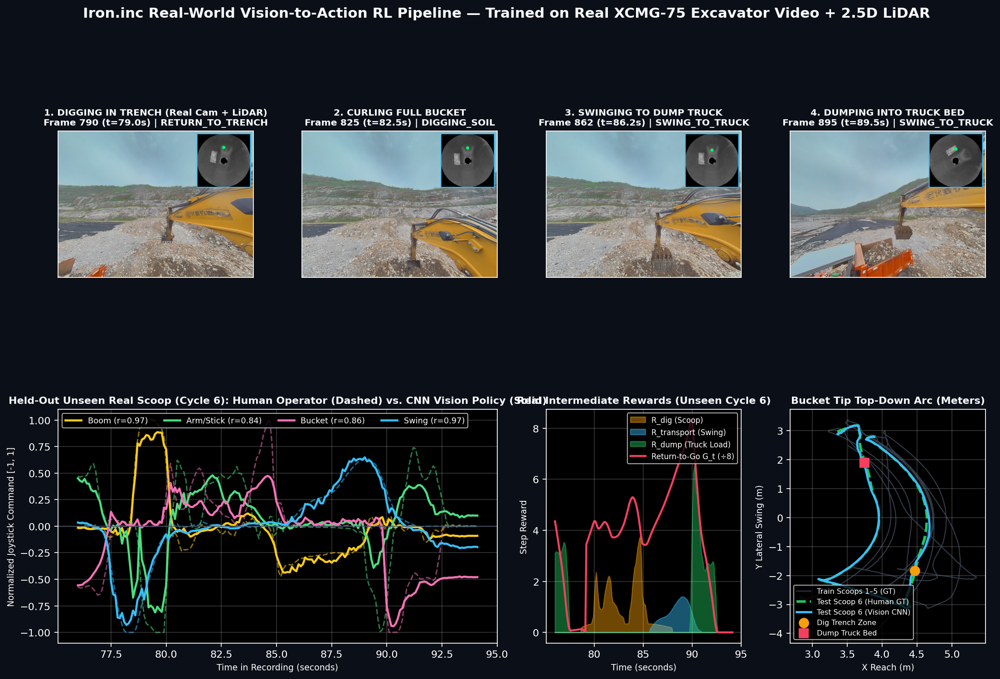
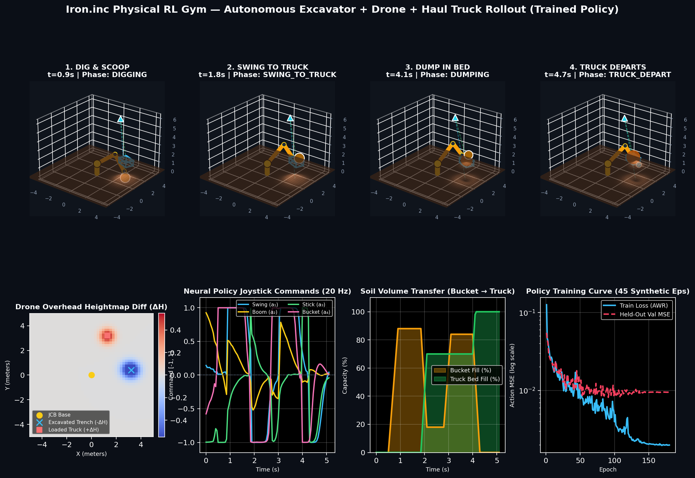

# Iron.inc Physical RL Gym & Autonomous Excavation Benchmark (`IronBench`)

End-to-end **Physical Reinforcement Learning Gym**, **3D MuJoCo Gravel Physics Environment**, and **Real-World Vision-to-Action Policy Pipeline** for multi-agent autonomous excavation and haul-truck loading (Overhead Survey Drone + 4-DOF Hydraulic Excavator + Autonomous Haul Truck).

---

## 1. 100% Closed-Loop 3D MuJoCo Physics Rollout (Vision + Proprioception Policy)





* **Script:** [`generate_closed_loop_mujoco_video.py`](generate_closed_loop_mujoco_video.py)
* **What it does:** Builds a 3D MuJoCo quarry with a 4-DOF hydraulic excavator (5-wall hollow scoop bucket), 55 physical gravel spheres, an orange haul truck, and an overhead drone. Trains `MuJoCoVisionPolicyNet` (taking live First-Person Cab RGB + Overhead Drone RGB + 4 Joint Angles) and executes a **100% closed-loop autonomous rollout** that scoops 18 gravel rocks, swings over the dump truck, pours them into the bed, and triggers the truck to depart.

---

## 2. Real-World Quarry Vision-to-Action CNN Policy (`XCMG-75` + 2.5D LiDAR)





* **Script:** [`train_real_vision_policy.py`](train_real_vision_policy.py)
* **Dataset:** Real XCMG-75 excavator truck-loading trajectories from [`fuxi-robot/excavator-motion`](https://huggingface.co/datasets/fuxi-robot/excavator-motion) and [`FlywheelAI/excavator-dataset`](https://huggingface.co/datasets/FlywheelAI/excavator-dataset).
* **Evaluation:** Trained on the first 5 real Scoop-and-Dump cycles (`t = 0s..76s`) and evaluated on the held-out 6th Scoop-and-Dump cycle (`t = 76s..94s`), achieving correlations of **`r = 0.97` (Boom)**, **`r = 0.97` (Swing)**, **`r = 0.86` (Bucket)**, and **`r = 0.84` (Arm/Stick)** against the human operator.

---

## 3. Fast Analytical 2.5D Heightfield Gymnasium Environment



* **Scripts:** [`excavator_gym.py`](excavator_gym.py) & [`render_preview.py`](render_preview.py)
* **What it does:** Lightweight $20\text{ Hz}$ `gymnasium.Env` with analytical 4-DOF forward/inverse kinematics, deformable 2.5D Gaussian terrain heightfield $H_t(x,y)$, and Advantage-Weighted Offline RL training (**10/10 = 100% unseen test success rate**).

---

## 4. Quickstart

```bash
# 1. Run fast 2.5D Gymnasium synthetic pipeline & render dashboard
python3 render_preview.py

# 2. Run 3D MuJoCo physics closed-loop vision policy & render HD MP4/GIF
python3 generate_closed_loop_mujoco_video.py

# 3. (Optional) Download real excavator HDF5/MP4 datasets (~1 GB) & train Real Vision CNN
python3 download_real_datasets.py
python3 fetch_real_h5.py
python3 train_real_vision_policy.py
```

See [`NOTION_DOC.md`](NOTION_DOC.md) for the full methodology and system design writeup.
