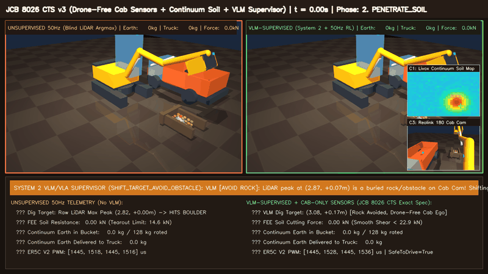

# Iron RL Gym v3 — JCB 8026 Backwards-from-Deployment Pipeline, Continuum Soil, VLM Supervisor & OpenGL Dust Engine

Autonomous excavation & truck-loading pipeline engineered **working backwards from the physical JCB 8026 CTS deployment** (`Two-week demo: hardware list — Cab-guided excavator · no hydraulic changes · no onboard computer`).




---

## 1. What's New in v3 (Collaborator Review Upgrades + Pretrained VLM Supervisor + OpenGL Volumetric Dust)

1. **Drone Dropped — 100% Cab-Mounted Sensor Suite (`deploy/sensors_io.py`):**
   - Removed the overhead DJI Mini 4 Pro drone for a cleaner MVP.
   - `compute_cab_ego_task_vec()` derives the 8D target vector (`task_vec`) directly in the cab frame from the **Livox Mid360S 3D LiDAR (`C1`)**, **Reolink Duo 2 PoE 180° Dual-Lens Cab Camera (`C3`)**, and **4x WitMotion WT901WIFI IMUs (`C4`)**.
2. **Pretrained VLM / VLA Semantic Supervisor (`deploy/vlm_supervisor.py`):**
   - Runs an asynchronous "System 2" semantic supervisor on top of the fast 50 Hz "System 1" policy (`JCB8026ActorCritic`).
   - Supports plug-and-play frontier VLMs (`backend="openai"` for **GPT-6 Astra / GPT-4o**, `backend="anthropic"` for **Claude Opus / Sonnet**, `backend="gemini"` for **Gemini 2.5 Pro**, `backend="qwen_vl"` for local Hugging Face **Qwen2.5-VL-7B-Instruct / PaliGemma-3B**, or `backend="local_fast"` for zero-latency offline ResNet-18 + LiDAR grounding).
   - Handles common-sense interventions that pure LiDAR heightmap `argmax` misses:
     - `SHIFT_TARGET_AVOID_OBSTACLE`: Recognizes buried boulders/pipes/obstacles on the cab camera and shifts the dig target to soft earth.
     - `ABORT_SWING_RETRY_SCOOP`: Detects under-filled buckets (`< 28%` fill) at lift and rewinds the phase clock to re-scoop.
     - `HOLD_1500US_SAFETY_WAIT`: Commands instant `1500 µs` neutral hold across all 4 ELRS servo channels if a hazard enters the slew radius or the truck isn't ready.
3. **Exact JCB 8026 CTS Official Spec-Sheet Geometry (`deploy/jcb8026_config.py`, `sim/jcb8026_env.py`):**
   - Locked to official JCB 8026 CTS dimensions: `2,867 kg` operating weight, `1.970 m` track length, `1.550 m` width over tracks, `1.145 m` tail swing radius, `2.400 m` cab roof height, `2.100 m` boom, `1.300 m` dipper, `0.08 m³` (`128 kg`) bucket capacity, `22.9 kN` bucket tearout force, and `14.6 kN` dipper tearout force.
4. **Continuum Deformable Soil Engine + FEE Soil-Cutting Forces (`ContinuumSoilEngine` in `sim/jcb8026_env.py`):**
   - Replaces simple rolling spheres with a **2.5D Deformable Continuum Earth Heightfield** featuring **Angle-of-Repose Slumping ($\phi = 34^\circ$)** and **Fundamental Earthmoving Equation (FEE / Reece)** soil-cutting resistance forces ($\text{kN}$) applied directly to the MuJoCo bucket teeth.
5. **OpenGL 3.3+ GLSL Volumetric Dust & LiDAR Backscatter Engine (`sim/opengl_dust_renderer.py`):**
   - Simulates up to **50,000+ GPU-accelerated 3D airborne dust particles** governed by Stokes settling drag, ambient wind advection, and divergence-free curl-noise vorticity.
   - Renders soft, depth-tested volumetric dust plumes using a **4-Octave 3D Fractional Brownian Motion (`fBM`) GLSL Fragment Shader** with **Beer-Lambert Mie scattering** and hardware Z-buffer soft-particle fading against MuJoCo's depth buffer.
   - Includes `sample_livox_lidar_with_dust_backscatter()` (905 nm laser Mie backscatter simulation) and `filter_airborne_dust_from_lidar_pointcloud()` (3D voxel density de-dusting filter).

---

## 2. Repository Structure

```text
iron_rl_gym/
├── deploy/                      # 1. PHYSICAL JCB 8026 RUNTIME (50 Hz ELRS Control Loop)
│   ├── jcb8026_config.py        # Exact JCB 8026 CTS dimensions, ISO Ch1-4 mapping, CRSF packet encoder
│   ├── sensors_io.py            # Cab-only sensor suite: 4x WitMotion WT901 UDP, Livox Mid360S, Reolink 180° PoE
│   ├── vlm_supervisor.py        # System 2 Pretrained VLM Supervisor (OpenAI/Anthropic/Gemini/Qwen2.5-VL/Local)
│   └── elrs_control_node.py     # 50 Hz multiplexer (Xbox Manual | Shadow Mode | Autonomous + VLM & Deadman Gate)
├── models/                      # 2. UNIFIED MULTIMODAL POLICY (System 1 @ 50 Hz)
│   └── policy.py                # 3-Branch JCB8026ActorCritic (Proprio + Task Pose + Livox Map + Cab RGB -> 4 Sticks)
├── train/                       # 3. IMITATION LEARNING (BC) -> RL FINE-TUNING PIPELINE
│   └── il_to_rl_pipeline.py     # Stage 1 Behavior Cloning -> Stage 2 Advantage-Weighted Actor-Critic RL
├── sim/                         # 4. ONE CORE 3D MUJOCO SIMULATOR + CONTINUUM SOIL + OPENGL DUST
│   ├── jcb8026_env.py           # Canonical JCB8026BenchEnv + ContinuumSoilEngine (FEE kN forces & trench carving)
│   └── opengl_dust_renderer.py  # OpenGL 3.3+ GLSL 3D fBM Volumetric Dust & Livox 905nm LiDAR Backscatter Engine
├── benchmark/                   # 5. IRONBENCH-8026 BENCHMARK & VISUALIZERS
│   ├── run_benchmark.py         # Evaluates Random vs Stage 1 BC vs Stage 2 RL across T1-T5 scenarios
│   ├── render_vlm_intervention_demo.py # Renders Unsupervised vs VLM-Supervised boulder avoidance & soil demo
│   ├── render_jcb8026_rollout_video.py # Renders Stage 1 BC vs Stage 2 RL side-by-side rollout
│   └── leaderboard.md           # Quantitative benchmark scorecard
└── archive_v1/                  # Archived v1 prototype scripts
```

---

## 3. Exact 4-Channel ISO Joystick Mapping (Section 3.3 of Hardware Spec)

| Channel | Tensor Index | Physical Servo Pod Axis | JCB 8026 Hydraulic Function |
| :--- | :---: | :--- | :--- |
| **Channel 1** | `action[0]` | Left Stick Fore-Aft | **Dipper (Stick)** |
| **Channel 2** | `action[1]` | Left Stick Side-to-Side | **Slew (Cab Swing)** |
| **Channel 3** | `action[2]` | Right Stick Fore-Aft | **Boom** |
| **Channel 4** | `action[3]` | Right Stick Side-to-Side | **Bucket Curl / Dump** |

---

## 4. Instructions: How to Configure the Pretrained VLM & OpenGL Volumetric Dust Engine

### A. Connecting a Pretrained Frontier VLM (`deploy/vlm_supervisor.py`)
1. Export your API key (or edit lines `38–40` of [`deploy/vlm_supervisor.py`](deploy/vlm_supervisor.py)):
   ```bash
   # Option 1: OpenAI (GPT-6 Astra / GPT-4o)
   export OPENAI_API_KEY="sk-proj-..."

   # Option 2: Anthropic (Claude Opus 5.5 / Sonnet 5.5)
   export ANTHROPIC_API_KEY="sk-ant-..."

   # Option 3: Google Gemini (Gemini 2.5 Pro / Flash)
   export GEMINI_API_KEY="AIzaSy..."
   ```
2. Initialize `CabVLMSupervisor` with your chosen backend:
   ```python
   from deploy.vlm_supervisor import CabVLMSupervisor

   # Choose backend: "openai" | "anthropic" | "gemini" | "qwen_vl" | "local_fast"
   supervisor = CabVLMSupervisor(backend="openai", device="mps")
   decision = supervisor.inspect_and_intervene(
       cab_rgb_u8_or_f32=cab_rgb,
       soil_heightmap_2d=env.soil_engine.heightmap,
       grid_x=env.soil_engine.grid_x,
       grid_y=env.soil_engine.grid_y,
       obstacle_xyz=obstacle_xyz,
       obstacle_radius=0.16,
       bucket_fill_ratio=fill_ratio,
       cycle_time_sec=env.phase_clock_sec,
       truck_bed_xyz=truck_bed_xyz,
   )
   ```
   *(If you prefer a local Hugging Face VLM without API keys, `pip install transformers accelerate` and pass `backend="qwen_vl"` to load `Qwen/Qwen2.5-VL-7B-Instruct` or `google/paligemma2-3b-pt-448`).*

---

### B. Running the OpenGL 3.3+ Volumetric Dust & LiDAR Backscatter Engine (`sim/opengl_dust_renderer.py`)
1. Install ModernGL for hardware OpenGL 3.3+ core-profile shader execution:
   ```bash
   pip install moderngl
   ```
2. Attach `OpenGLVolumetricDustEngine` to your MuJoCo rendering & LiDAR loop:
   ```python
   import mujoco
   import numpy as np
   from sim.jcb8026_env import JCB8026BenchEnv
   from sim.opengl_dust_renderer import (
       OpenGLVolumetricDustEngine,
       sample_livox_lidar_with_dust_backscatter,
       filter_airborne_dust_from_lidar_pointcloud,
   )

   env = JCB8026BenchEnv(scenario="T1_Nominal", seed=42)
   obs, _ = env.reset()

   # 1. Enable depth rendering in MuJoCo and initialize the 50,000-particle OpenGL Dust Engine
   mj_renderer = mujoco.Renderer(env.model, height=720, width=1280)
   dust_engine = OpenGLVolumetricDustEngine(width=1280, height=720, max_particles=50000)

   # 2. Inside the simulation loop, emit dust whenever soil is cut or poured into the truck:
   bkt_xyz = env.data.site_xpos[env.bucket_site_id].copy()
   dust_engine.emit_dust_burst(
       source_xyz=bkt_xyz,
       jet_velocity_xyz=np.array([0.4, 0.2, 1.1], dtype=np.float32),
       intensity_kg_s=env.soil_engine.last_fee_force_kn * 3.5,
   )
   dust_engine.step_physics(dt=env.dt)

   # 3. Render MuJoCo RGB + Depth buffers and composite the GLSL 3D fBM dust shader:
   mj_renderer.update_scene(env.data, camera="cinema_cam")
   rgb_u8 = mj_renderer.render()
   mj_renderer.enable_depth_rendering()
   depth_f32 = mj_renderer.render()
   mj_renderer.disable_depth_rendering()

   frame_with_dust = dust_engine.render_over_mujoco_frame(
       mujoco_rgb_u8=rgb_u8,
       mujoco_depth_f32=depth_f32,
       view_matrix_4x4=np.eye(4, dtype=np.float32),
       proj_matrix_4x4=np.eye(4, dtype=np.float32),
   )

   # 4. Simulate Livox Mid360S 905nm dust backscatter & filter ghost points before heightmap projection:
   noisy_lidar_xyz = sample_livox_lidar_with_dust_backscatter(
       cab_lidar_origin_xyz=np.array([0.48, 0.34, 2.32], dtype=np.float32),
       true_terrain_points_xyz=env.data.xpos[env.soil_body_ids],
       dust_engine=dust_engine,
   )
   clean_lidar_xyz = filter_airborne_dust_from_lidar_pointcloud(noisy_lidar_xyz)
   ```

---

## 5. Quickstart Commands

```bash
# 1. Run Stage 1 (BC) -> Stage 2 (RL Fine-Tuning) + Full T1-T5 IronBench-8026 Suite
python3 benchmark/run_benchmark.py

# 2. Render the VLM/VLA Semantic Supervisor + Continuum Soil Demo Video & Dashboard
python3 benchmark/render_vlm_intervention_demo.py
```
