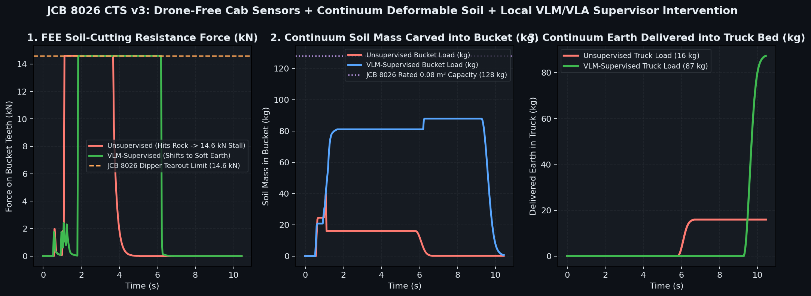

# Iron RL Gym v3 — JCB 8026 Backwards-from-Deployment Pipeline, Continuum Soil & VLM Supervisor

Autonomous excavation & truck-loading pipeline engineered **working backwards from the physical JCB 8026 CTS deployment** (`Two-week demo: hardware list — Cab-guided excavator · no hydraulic changes · no onboard computer`).




---

## 1. What's New in v3 (Collaborator Review Upgrades + System 2 VLM Supervisor)

1. **Drone Dropped — 100% Cab-Mounted Sensor Suite (`deploy/sensors_io.py`):**
   - Removed the overhead DJI Mini 4 Pro drone for a cleaner MVP.
   - `compute_cab_ego_task_vec()` derives the 8D target vector (`task_vec`) directly in the cab frame from the **Livox Mid360S 3D LiDAR (`C1`)**, **Reolink Duo 2 PoE 180° Dual-Lens Cab Camera (`C3`)**, and **4x WitMotion WT901WIFI IMUs (`C4`)**.
2. **Local PyTorch VLM / VLA Semantic Supervisor (`deploy/vlm_supervisor.py`):**
   - Runs an asynchronous "System 2" semantic supervisor (`LocalVLASemanticBackbone`: `torchvision` ResNet-18 visual trunk + 2-channel Livox LiDAR spatial head) on top of the fast 50 Hz "System 1" policy (`JCB8026ActorCritic`).
   - Handles common-sense interventions that pure LiDAR heightmap `argmax` misses:
     - `SHIFT_TARGET_AVOID_OBSTACLE`: Recognizes buried boulders/pipes/obstacles on the cab camera and shifts the dig target to soft earth.
     - `ABORT_SWING_RETRY_SCOOP`: Detects under-filled buckets (`< 28%` fill) at lift and rewinds the phase clock to re-scoop.
     - `HOLD_1500US_SAFETY_WAIT`: Commands instant `1500 µs` neutral hold across all 4 ELRS servo channels if a hazard enters the slew radius or the truck isn't ready.
3. **Exact JCB 8026 CTS Official Spec-Sheet Geometry (`deploy/jcb8026_config.py`, `sim/jcb8026_env.py`):**
   - Locked to official JCB 8026 CTS dimensions: `2,867 kg` operating weight, `1.970 m` track length, `1.550 m` width over tracks, `1.145 m` tail swing radius, `2.400 m` cab roof height, `2.100 m` boom, `1.300 m` dipper, `0.08 m³` (`128 kg`) bucket capacity, `22.9 kN` bucket tearout force, and `14.6 kN` dipper tearout force.
4. **Continuum Deformable Soil Engine + FEE Soil-Cutting Forces (`ContinuumSoilEngine` in `sim/jcb8026_env.py`):**
   - Replaces simple rolling spheres with a **2.5D Deformable Continuum Earth Heightfield** featuring **Angle-of-Repose Slumping ($\phi = 34^\circ$)** and **Fundamental Earthmoving Equation (FEE / Reece)** soil-cutting resistance forces ($\text{kN}$) applied directly to the MuJoCo bucket teeth.

---

## 2. Repository Structure

```text
iron_rl_gym/
├── deploy/                      # 1. PHYSICAL JCB 8026 RUNTIME (50 Hz ELRS Control Loop)
│   ├── jcb8026_config.py        # Exact JCB 8026 CTS dimensions, ISO Ch1-4 mapping, CRSF packet encoder
│   ├── sensors_io.py            # Cab-only sensor suite: 4x WitMotion WT901 UDP, Livox Mid360S, Reolink 180° PoE
│   ├── vlm_supervisor.py        # System 2 Local VLM/VLA Semantic Supervisor (Obstacle/Retry/Hold interventions)
│   └── elrs_control_node.py     # 50 Hz multiplexer (Xbox Manual | Shadow Mode | Autonomous + VLM & Deadman Gate)
├── models/                      # 2. UNIFIED MULTIMODAL POLICY (System 1 @ 50 Hz)
│   └── policy.py                # 3-Branch JCB8026ActorCritic (Proprio + Task Pose + Livox Map + Cab RGB -> 4 Sticks)
├── train/                       # 3. IMITATION LEARNING (BC) -> RL FINE-TUNING PIPELINE
│   └── il_to_rl_pipeline.py     # Stage 1 Behavior Cloning -> Stage 2 Advantage-Weighted Actor-Critic RL
├── sim/                         # 4. ONE CORE 3D MUJOCO SIMULATOR + CONTINUUM SOIL ENGINE
│   └── jcb8026_env.py           # Canonical JCB8026BenchEnv + ContinuumSoilEngine (FEE kN forces & trench carving)
├── benchmark/                   # 5. IRONBENCH-8026 BENCHMARK & VISUALIZERS
│   ├── run_benchmark.py         # Evaluates Random vs Stage 1 BC vs Stage 2 RL across T1-T5 scenarios
│   ├── render_vlm_intervention_demo.py # Renders Unsupervised vs VLM-Supervised boulder avoidance & soil demo
│   ├── render_jcb8026_rollout_video.py # Renders Stage 1 BC vs Stage 2 RL side-by-side rollout
│   └── leaderboard.md           # Quantitative benchmark scorecard
└── archive_v1/                  # Archived v1 prototype scripts
```

---

## 3. Exact 4-Channel ISO Joystick Mapping (Section 3.3 of Hardware Spec)

| Channel | Tensor Index | Physical Servo Pod Axis | JCB 8026 Hydraulic Function |
| :--- | :---: | :--- | :--- |
| **Channel 1** | `action[0]` | Left Stick Fore-Aft | **Dipper (Stick)** |
| **Channel 2** | `action[1]` | Left Stick Side-to-Side | **Slew (Cab Swing)** |
| **Channel 3** | `action[2]` | Right Stick Fore-Aft | **Boom** |
| **Channel 4** | `action[3]` | Right Stick Side-to-Side | **Bucket Curl / Dump** |

---

## 4. Quickstart

```bash
# 1. Run Stage 1 (BC) -> Stage 2 (RL Fine-Tuning) + Full T1-T5 IronBench-8026 Suite
python3 benchmark/run_benchmark.py

# 2. Render the VLM/VLA Semantic Supervisor + Continuum Soil Demo Video & Dashboard
python3 benchmark/render_vlm_intervention_demo.py
```
