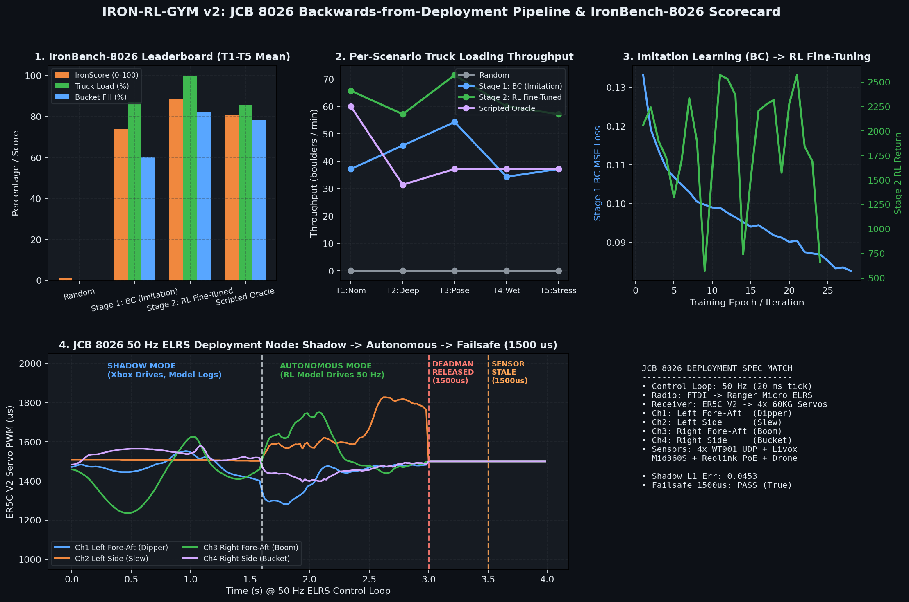

# Iron RL Gym v2 — JCB 8026 Backwards-from-Deployment Pipeline & `IronBench-8026`

Autonomous excavation & truck-loading pipeline engineered **working backwards from the physical JCB 8026 CTS deployment** (`Two-week demo: hardware list — Drone-guided excavator · no hydraulic changes · no onboard computer`).



---

## 1. Architecture: Working Backwards from the JCB 8026

Every module in this repository shares the exact same 50 Hz sensor-to-ELRS-stick tensor contract as the physical ground laptop:

```text
iron_rl_gym/
├── deploy/                      # 1. PHYSICAL JCB 8026 RUNTIME (50 Hz ELRS Control Loop)
│   ├── jcb8026_config.py        # ISO Ch1-4 mapping, PWM 1000-2000us, CRSF packet encoder
│   ├── sensors_io.py            # 4x WitMotion WT901 UDP, Livox Mid360S map, Reolink RTSP, Drone AprilTag
│   └── elrs_control_node.py     # 50 Hz multiplexer (Xbox Manual | Shadow Mode | Autonomous + Deadman Gate)
├── models/                      # 2. UNIFIED MULTIMODAL POLICY
│   └── policy.py                # JCB8026ActorCritic (Proprio + Task Pose + Livox Heightmap + Cab RGB -> 4 ISO Sticks)
├── train/                       # 3. IMITATION LEARNING (BC) -> RL FINE-TUNING PIPELINE
│   └── il_to_rl_pipeline.py     # Stage 1 Behavior Cloning from Xbox teleop -> Stage 2 TD3+BC / AWR RL
├── sim/                         # 4. ONE CORE 3D MUJOCO SIMULATOR
│   └── jcb8026_env.py           # Canonical JCB8026BenchEnv (JCB 8026 geometry, 60KG servo lag, gravel physics)
├── benchmark/                   # 5. IRONBENCH-8026 AUTONOMOUS DIGGING BENCHMARK
│   ├── run_benchmark.py         # Evaluates Random vs Stage 1 BC vs Stage 2 RL across T1-T5 scenarios
│   └── leaderboard.md           # Auto-generated quantitative benchmark scorecard
└── archive_v1/                  # Archived v1 prototype scripts
```

### Exact 4-Channel ISO Joystick Mapping (Section 3.3 of Hardware Spec)
At **50 Hz (`20 ms` tick)**, the policy outputs 4 normalized stick values `[-1, +1]^4` which `deploy/jcb8026_config.py` encodes into **26-byte ExpressLRS CRSF frames (`1000..2000 µs`, neutral failsafe `1500 µs`)** over the **Adafruit FTDI Friend (B5) $\rightarrow$ Radiomaster Ranger Micro 2.4GHz ELRS (B4) $\rightarrow$ ER5C V2 Receiver (E7) $\rightarrow$ 4x ANNIMOS 60KG Servos (E1)**:

| Channel | Tensor Index | Physical Servo Pod Axis | JCB 8026 Hydraulic Function |
| :--- | :---: | :--- | :--- |
| **Channel 1** | `action[0]` | Left Stick Fore-Aft | **Dipper (Stick)** |
| **Channel 2** | `action[1]` | Left Stick Side-to-Side | **Slew (Cab Swing)** |
| **Channel 3** | `action[2]` | Right Stick Fore-Aft | **Boom** |
| **Channel 4** | `action[3]` | Right Stick Side-to-Side | **Bucket Curl / Dump** |

### Physical Sensor Suite $\leftrightarrow$ Model Inputs (Section 4 of Hardware Spec)
- **`proprio` (`float32[12]`):** 4x **WitMotion WT901WIFI** wireless 6-axis tilt angles (`[dipper, slew, boom, bucket]`) + 4 angular velocities + 4 current servo stick positions.
- **`task_vec` (`float32[8]`):** Relative `[dx, dy, dz]` of the trench and dump truck bed from the overhead **DJI Mini 4 Pro (A1)** tracking matte-laminated **A3 AprilTags (F1/F2)** via **WildBridge (A2)**.
- **`livox_elevation` (`float32[1, 32, 32]`):** Local 2.5D elevation heightmap projected from the upside-down cab-roof **Livox Mid360S 3D LiDAR (C1)**.
- **`cab_rgb` (`float32[3, 64, 64]`):** Cab-roof **Reolink Duo 2 PoE (C3)** camera crop looking along the boom.

---

## 2. Quickstart: Run Training & Benchmark (`IronBench-8026`)

```bash
# Run Stage 1 (Imitation Learning / BC) -> Stage 2 (RL Fine-Tuning) + Full T1-T5 Benchmark Suite
python3 benchmark/run_benchmark.py
```

See [benchmark/leaderboard.md](benchmark/leaderboard.md) for the latest quantitative scorecard across `T1_Nominal`, `T2_DeepTrench`, `T3_RandomTruckPose`, `T4_HeavyWetSoil`, and `T5_Sim2Real_Stress`.
